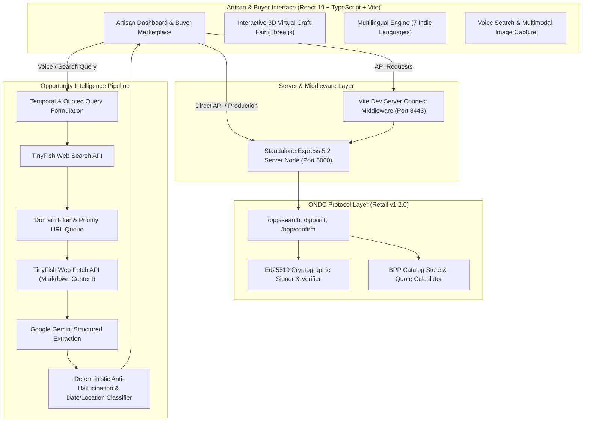
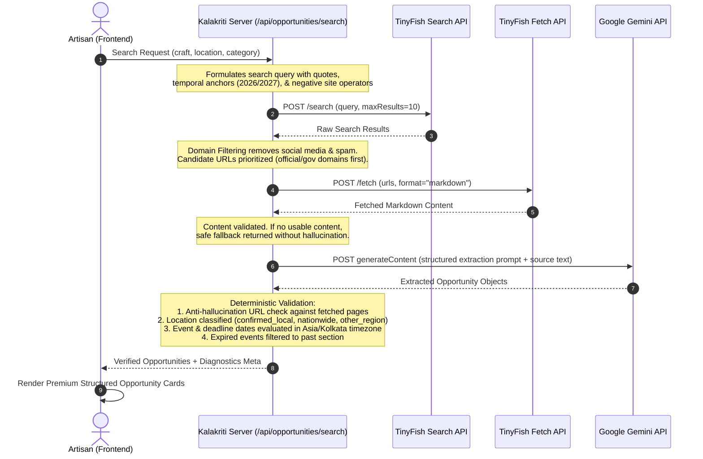

# Kalakriti (कलाकृति) 🏺

### AI-Powered Heritage Handicraft Marketplace & Opportunity Intelligence Engine

> **AZINHACK '26 Hackathon Project Submission**
> Empowering traditional Indian artisans through AI-driven opportunity discovery, 3D virtual craft fairs, multilingual accessibility, and an ONDC-ready seller architecture.

---

## 1. Project Overview

**Kalakriti** is an intelligent digital platform built to bridge the gap between traditional Indian handicraft artisans and modern digital commerce. Combining low-literacy mobile-first design with state-of-the-art AI, Kalakriti helps artisans:

1. **Discover Genuine Craft Opportunities**: Real-time exhibitions, government schemes (e.g., PM Vishwakarma, AHVY), buyer-seller meets, and skill development workshops extracted from verified web sources via **TinyFish** and **Google Gemini**.
2. **Showcase Handicrafts in an Interactive 3D Craft Fair**: A playable 2.5D/3D virtual mela promenade where buyers explore themed stalls (Terracotta Pottery, Madhubani Painting, Woodcraft, Silk Weaving, Silver Filigree, Zardozi Embroidery), interact with 3D product previews, and add items directly to an integrated cart.
3. **Engage Buyers via ONDC-Aligned Architecture**: An implementation of the Open Network for Digital Commerce (ONDC Retail v1.2.0) BPP (Buyer Protocol Provider) seller node featuring Beckn cryptographic authentication and standard catalog discovery.
4. **Overcome Language & Literacy Barriers**: Full native UI localization across **7 Indic languages** (English, हिन्दी, मराठी, বাংলা, ગુજરાતી, தமிழ், తెలుగు) with integrated voice search and visual storytelling.

---

## 2. Problem Statement

India is home to over 7 million traditional handicraft artisans, yet the majority remain economically vulnerable due to systemic bottlenecks:

- **Information Asymmetry**: Crucial craft fairs (Dilli Haat, Surajkund, Saras Mela) and subsidized government schemes (DBT grants, stall subsidies, toolkits) are scattered across fragmented official notices and portals. Deadlines frequently expire before artisans hear about them.
- **Geographic & Category Mismatch**: Artisans waste time and money traveling to fairs irrelevant to their craft or location.
- **Digital Literacy & Language Barriers**: Most e-commerce dashboards require complex text inputs in English, alienating rural master craftspeople.
- **Intermediary Exploitation**: Without direct access to buyer networks or decentralized digital marketplaces, artisans receive only a fraction of their products' final market value.

Kalakriti addresses these challenges with an intuitive, audio-enabled, multilingual interface and an automated, source-grounded opportunity intelligence pipeline.

---

## 3. System Architecture



---

## 4. Key Features (Grounded in Implementation)

### 🏺 1. Artisan Dashboard & Inventory Management

- **One-Tap Catalog Management**: Add products with title, craft description, materials, price, dimensions, and authentic craft tags.
- **KalaPramaan Digital Certificate**: Generate cryptographic craft provenance certificates honoring traditional artisan lineages.
- **Clean Store Identity**: Uncluttered store banner with ONDC Ready status indicator, responsive tab navigation, and language switcher.

### 🎪 2. Interactive 3D Virtual Craft Fair (`GameWorld.tsx`)

- **6 Dynamic Stalls**: Stalls adapt to inventory categories (Pottery, Painting, Woodcraft, Weaving, Jewellery, Embroidery).
- **Smooth 3D Exploration**: First-person/third-person promenade navigation with collision boundaries, delta-normalized movement, and touch virtual D-pad controls for mobile devices.
- **Interactive Stalls & Tilt Cards**: Walk up to stalls to inspect products with 3D specular glare, add items to cart, or proceed directly to ONDC checkout.

### 🌐 3. Multilingual Accessibility across 7 Indic Languages

- Complete translation of all interface tokens, gamification quests, level badges, and opportunity labels across **English, Hindi, Marathi, Bengali, Gujarati, Tamil, and Telugu**.
- Integrated voice input utilizing Gemini audio transcription to enable natural speech query entry.

### 🔍 5. Craft Opportunity Finder (Powered by TinyFish & Gemini)

- Automated discovery of exhibitions, fairs, government schemes, buyer meets, and training programs tailored to the artisan's craft and city.
- **Reference Structured Opportunity Cards**: High-contrast, clean visual hierarchy featuring category pills, green "Source Found" badges, serif headings, accurate location pins, 2x2 key facts grid, "Why this helps you" panels, actionable step lists with green checkmarks, and dark-brown official source CTA buttons.
- **Honest Segregation**: Raw search results that cannot be verified are placed in a separate, clearly labeled unverified sources section, never masquerading as verified cards.

### 🇮🇳 6. ONDC Retail v1.2.0 BPP Seller Node Implementation

- **Protocol Adherence**: Implements Beckn Retail 1.2.0 endpoints (`/bpp/search`, `/bpp/init`, `/bpp/confirm`).
- **Cryptographic Security**: Ed25519 keypair generation and Beckn authorization header verification (`Authorization: Signature ...`).
- **Status Disclosure**: Implemented as an in-memory BPP seller node and staging test harness. It does _not_ claim official live production certification on the central ONDC registry.

---

## 5. TinyFish Integration & Opportunity Pipeline

The Opportunity Finder combines **TinyFish Search**, **TinyFish Fetch**, and **Google Gemini** into a secure, hallucination-resistant pipeline:



### Pipeline Integrity Guarantees

1. **Server-Side Key Isolation**: `TINYFISH_API_KEY` is loaded and accessed _strictly_ within backend Node.js runtimes (`server.js` or Vite server connect middleware). It is never prefixed with `VITE_` and never included in client JavaScript bundles.
2. **Anti-Hallucination Source Locking**: Opportunities extracted by Gemini are checked against the normalized URLs of pages actually fetched by TinyFish. Any opportunity referencing an unfetched URL is discarded.
3. **Temporal Classification**: Dates are resolved in `Asia/Kolkata` time against the current reference date. Events whose end dates have elapsed or whose deadlines have closed are automatically moved to a dedicated "Past Events" partition with explicit warnings.
4. **Honest Fallback Behavior**: If upstream network connectivity is unavailable or API keys are missing, the pipeline displays raw web search links with an explicit notice (`Direct Web Link • Not structured by AI`), never inventing missing dates, fees, or eligibility.

---

## 6. Technology Stack

| Layer                       | Technology                                      | Purpose                                                                   |
| --------------------------- | ----------------------------------------------- | ------------------------------------------------------------------------- |
| **Frontend Framework**      | React 19 (`^19.0.0`), TypeScript 5.7            | Component architecture and type safety                                    |
| **Build Tool & Bundler**    | Vite 8 (`^8.0.5`), `@vitejs/plugin-react`       | Ultra-fast HMR and production bundling                                    |
| **Styling & Design System** | Tailwind CSS v4 (`^4.0.0`), `@tailwindcss/vite` | Modern utility-first styling                                              |
| **3D & Canvas**             | Three.js, Custom 2.5D/3D Parallax               | Interactive 3D Craft Fair promenade                                       |
| **Backend Node Server**     | Express 5.2.1, Node.js, `dotenv`                | ONDC BPP seller node and opportunity search API                           |
| **Protocol & Cryptography** | Ed25519 (`crypto`), Beckn Protocol v1.2.0       | ONDC request signing and signature verification                           |
| **Web Discovery & Fetch**   | TinyFish Search & Fetch APIs                    | Live handicraft web page discovery and markdown scraping                  |
| **AI & Multimodal**         | Google Gemini API (`gemini-2.5-flash`)          | Structured opportunity extraction, audio transcription, image enhancement |

---

## 7. Local Setup Guide

### Prerequisites

- Node.js (version 18.x, 20.x, or 22.x recommended)
- npm (version 9.x or higher)

### 1. Clone the Repository

```bash
git clone https://github.com/<your-username>/kalakriti.git
cd kalakriti
```

### 2. Install Dependencies

```bash
npm install
```

### 3. Configure Environment Variables

Copy the template file to create your local `.env`:

```bash
cp .env.example .env
```

Open `.env` in your editor and add your personal API keys (see [Environment Configuration](#8-environment-configuration) below).

### 4. Start the Development Server

```bash
npm run dev
```

The application will start on `http://localhost:8443` (or the configured port). The Vite development server includes built-in connect middleware for `/api/opportunities/search`, `/api/transcribe-audio`, and `/api/enhance-image`.

### 5. Optional: Start the Standalone ONDC Server Node

To run the standalone Express server for ONDC BPP endpoints:

```bash
node server.js
```

The ONDC Seller Node will initialize on `http://localhost:5000` with Ed25519 cryptographic keypair generation.

---

## 8. Environment Configuration

All environment variables must be configured in your local `.env` file. A template with placeholders is provided in [`.env.example`](file:///Users/ankit/kalakriti/.env.example):

```env
# Google Gemini API Key from https://aistudio.google.com/app/apikey
# Used for Opportunity Extraction, Voice Transcription, and Image Enhancement
VITE_GEMINI_KEY=your_gemini_api_key_here

# Cloudinary Details from https://cloudinary.com/console
# Used for artisan product image uploads
VITE_CLOUDINARY_CLOUD_NAME=your_cloudinary_cloud_name_here
VITE_CLOUDINARY_UPLOAD_PRESET=your_unsigned_preset_here

# TinyFish API Key for live web search and page fetching (Server-side only)
# Get your key from your TinyFish account (https://tinyfish.ai)
# CRITICAL: Keep server-side only. NEVER prefix with VITE_
TINYFISH_API_KEY=your_tinyfish_api_key_here
```

### Variable Reference

| Variable                        | Scope                | Required                       | Description                                                                         |
| ------------------------------- | -------------------- | ------------------------------ | ----------------------------------------------------------------------------------- |
| `VITE_GEMINI_KEY`               | Client / Server      | Recommended                    | Google Gemini API key for structured opportunity extraction and voice transcription |
| `TINYFISH_API_KEY`              | **Server-side only** | Optional (for live web search) | TinyFish API key for live search queries and webpage markdown retrieval             |
| `VITE_CLOUDINARY_CLOUD_NAME`    | Client               | Optional                       | Cloudinary cloud name for artisan product photo uploads                             |
| `VITE_CLOUDINARY_UPLOAD_PRESET` | Client               | Optional                       | Unsigned Cloudinary upload preset                                                   |
| `PORT`                          | Server               | Optional                       | Port for Express server (defaults to 5000) or Vite server (defaults to 8443)        |

> 🔒 **Security Notice**: Never commit `.env` or real API keys to any public git repository. The repository's [`.gitignore`](file:///Users/ankit/kalakriti/.gitignore) is strictly configured to prevent `.env` and `.env.*` from being tracked.

---

## 9. Verification & Testing

The Kalakriti codebase includes a comprehensive automated test harness covering UI components, search pipeline validation, and buyer marketplace functionality.

### Test Execution Commands

```bash
# 1. UI Architecture & Card Design Tests (530 tests)
node test-opportunities-ui.js

# 2. Opportunity Search, Fetch & Anti-Hallucination Pipeline Tests (285 tests)
node test-opportunity-search.js

# 3. Buyer Marketplace, 3D Fair & Gamification Tests (75 tests)
node test-buyer-marketplace.js

# 4. TypeScript Strict Compilation Check
npx tsc --noEmit

# 5. Production Vite Build
npm run build
```

### Verified Test Results

```
======================================================
UI Tests Completed: 530 | Passed: 530 | Failed: 0
Opportunity Search Tests: 285 | Passed: 285 | Failed: 0
Buyer Marketplace Tests: 75 | Passed: 75 | Failed: 0
======================================================
Total Automated Tests: 890 Passed | 0 Failed (100% Pass Rate)
TypeScript Check: 0 Errors
Production Build: vite v8.2.2 built cleanly in ~390ms
```

---

## 10. Demo & Real-World Limitations

### How to Test Opportunity Discovery Locally

1. Launch the app with `npm run dev` and open the dashboard in your browser.
2. Navigate to the **Opportunities** tab (`अवसर`).
3. Enter a craft (e.g., `Pottery` or `ब्लू पॉटरी`) and a location (e.g., `Jaipur` or `जयपुर`).
4. Click **Search Opportunities** (`अवसर खोजें`).
5. When configured with valid API keys and network access, the engine retrieves matching source pages and displays structured reference opportunity cards.
6. When running offline or without external keys, the app safely displays fallback search links with transparent labels.

### Real-World Disclaimer & Limitations

- **Verification Required**: While the pipeline performs automated date, fee, and location extraction, artisans should always tap **View Official Source ↗** to verify exact eligibility criteria and deadlines directly with organizers before traveling or committing funds.
- **Upstream Network Dependency**: Live search and fetch require active outbound internet connectivity and valid API quotas from TinyFish and Google Gemini.
- **ONDC Network Scope**: The included ONDC adapter is a compliant Beckn Retail v1.2.0 BPP implementation with cryptographic signing designed for sandbox evaluation; joining the live production network requires registry onboarding through an authorized ONDC registrar.

----

## 11. Project Status & Contribution

- **Event**: AZINHACK '26 Hackathon
- **Track**: Digital Innovation, AI & Cultural Heritage Preservation
- **Repository Status**: Development build prepared for public showcase.
- **License**: Private / Hackathon Project Submission. All rights reserved by the original authors.
